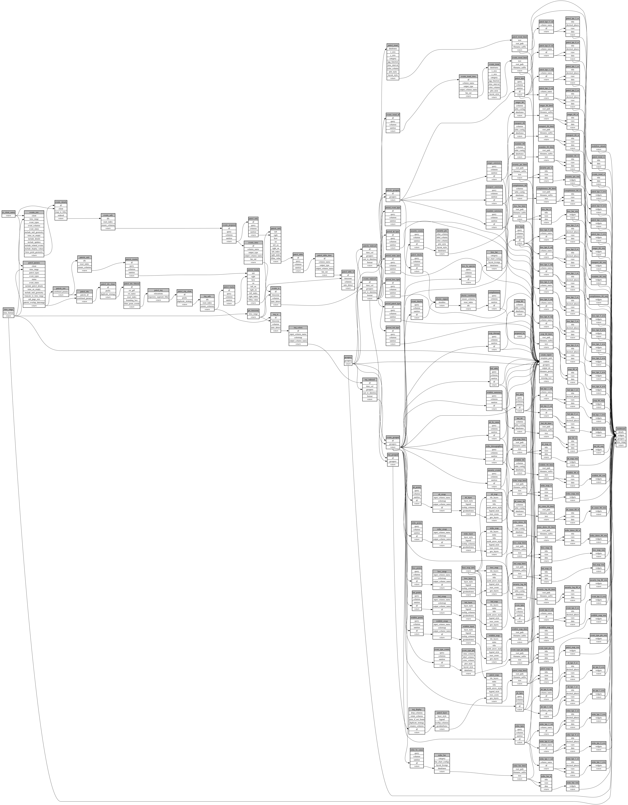

```
# AUTOGENERATED BY ECOSCOPE-WORKFLOWS; see fingerprint in README.md for details

```

```yaml
# fingerprint:
artifacts_sha256_basic: d53543eb53b28f7898ac03d80033199b41d49446d5eafa620c2502308d69fb2b
artifacts_sha256_strict: f6806aa7bd32b44e5d6b36d61415bbc3eded4723fc97ce32778338692d9c5a06
installed_requirements:
- channel: https://repo.prefix.dev/ecoscope-workflows/
  name: ecoscope-platform
  version: {version: ==2.28.0}
- channel: https://repo.prefix.dev/ecoscope-workflows-custom/
  name: ecoscope-workflows-ext-custom
  version: {version: ==0.1.5}
- channel: conda-forge
  name: pydeck
  version: {version: ==0.9.2}
params_sha256: ec3fde93747834a9548ef13ed78cf43bbd2eb4d0add8d5f1b3e2482fe5d7d361
spec_sha256: 08f7576b95694d7f225a567d911b8810a3f6f5b22a7af8a63d5a97e36688c960

```

# ecoscope-workflows-nl-conservancy-management-report-workflow


